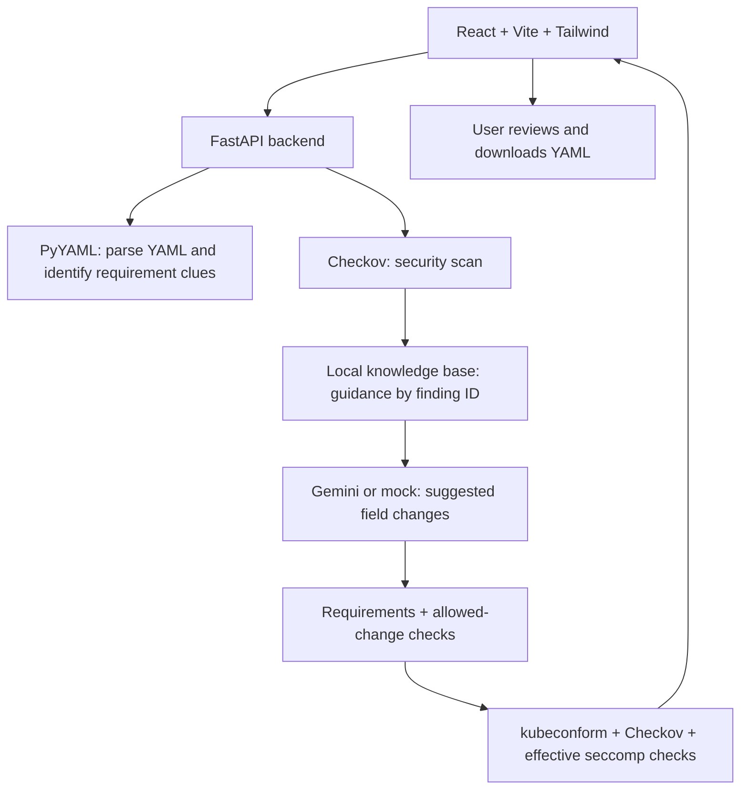

# ConfigShield AI

A local tool for reviewing Kubernetes security settings and checking proposed fixes before downloading YAML.

- Scans seven security policies with Checkov.
- Retrieves reviewed Kubernetes and OWASP guidance.
- Uses optional Gemini suggestions or a mock mode that needs no API key.
- Checks proposed changes against application requirements and validates the candidate.
- Shows original/candidate YAML, changed fields, and verification results. Never deploys to a cluster.

## Architecture



## How it works

1. **Upload YAML or load an example.** Parsing, scanning, and guidance retrieval start automatically.
2. **Review requirements.** Accept or edit suggestions; unconfirmed answers remain Unknown.
3. **Request a suggestion.** Choose mock mode or explicitly ask Gemini for one finding.
4. **Approve and build.** Compare the original, candidate, and bullet explanations of changes.
5. **Verify and download.** Review schema, security, and requirement checks, then acknowledge export.

## Scope

- One Linux `apps/v1` Deployment, one application container, one YAML document, up to 256 KiB.
- Checks: privileged mode, privilege escalation, non-root execution, NET_RAW, seccomp, capability dropping, and service-account tokens.
- No extra/init/ephemeral containers or YAML aliases.
- Static checks do not prove runtime compatibility or complete security.

## Setup ? Windows PowerShell

- Install **Git**, **Python 3.12**, and **Node.js**. Tested with Node 24.14.0.
- No Docker, Kubernetes cluster, or API key is needed for mock mode.
- Run:

```powershell
git clone https://github.com/EdsonRay05/configshield-ai.git
cd configshield-ai

py -3.12 -m venv backend\.venv
.\backend\.venv\Scripts\python.exe -m pip install -r backend\requirements.txt
.\backend\.venv\Scripts\python.exe -m venv backend\.scanner-venv
.\backend\.scanner-venv\Scripts\python.exe -m pip install -r backend\scanner-requirements.txt
powershell -NoProfile -ExecutionPolicy Bypass -File backend\tools\install-kubeconform.ps1

cd frontend
npm.cmd ci
cd ..
```

- If `py -3.12` is unavailable, use the full path to your Python 3.12 executable.
- Dependencies and validator files need internet access during installation. Tool downloads have pinned checksums.
- Other operating systems need adapted Python/tool paths; Windows is the tested setup.

## Run

Open **two terminals in the project root**.

Backend:

```powershell
cd backend
.\.venv\Scripts\python.exe -m uvicorn app.main:app --host 127.0.0.1 --port 8000
```

Frontend:

```powershell
cd frontend
npm.cmd run dev
```

- Open **http://127.0.0.1:5173**. Keep both terminals running; Ctrl+C stops them.
- First demo: load **CKV_K8S_16 / explicit**. For this controlled case, set API/privileged access to Not required and non-root compatibility to Yes. Generate a mock example, build, verify, and review the download.
- For your own application, confirm its actual requirements or leave them Unknown.

## Optional Gemini

- Create your own key in [Google AI Studio](https://aistudio.google.com/api-keys).
- Save the following in **`backend/.env`**. Set the last value to true only after confirming billing is disabled for that project.

```dotenv
AI_PROVIDER=gemini
GEMINI_MODEL=gemini-3.1-flash-lite
GEMINI_API_KEY=YOUR_PRIVATE_KEY
GEMINI_FREE_TIER_CONFIRMED=true
```

- Restart the backend. It loads `.env` automatically; process environment variables override the file.
- Keep your key out of Git and frontend code. Each developer uses their own key.
- Green status means local configuration is ready; authentication/quota are checked only when Gemini is called.
- No automatic generation, retries, or paid fallback. Quota errors leave scanning and mock mode available.

## Data and evaluation

- **Dataset:** 42 controlled test entries plus one KustomizeGoat Deployment. These are test inputs, not model training data.
- **Knowledge base:** reviewed guidance retrieved by exact Checkov ID, separate from the dataset.
- **Evaluation:** offline fixtures test the pipeline. The three-request live pilot produced no accepted candidates; model superiority is not established. [Results and limitations](docs/evaluation.md).

## Tests

From the project root:

```powershell
cd backend
.\.venv\Scripts\python.exe -m pytest -q
cd ..\frontend
npm.cmd test
npm.cmd run build
```

- Optional: `npm.cmd run test:browser` from `frontend`. Requires installed Microsoft Edge and unused ports 8001/5174; uses mock mode, not live Gemini.
- [Validation report](docs/verification.md): recorded test results, browser checks, and remaining human/runtime checks.

## Troubleshooting

- **Backend unavailable:** start FastAPI on port 8000 and use the Vite URL above.
- **Checkov unavailable:** install scanner dependencies into `backend/.scanner-venv`.
- **Verification incomplete:** check the reported error and rerun the validator installer if needed.
- **Requirement conflict:** review the application need; do not change an accurate answer just to enable a fix.

## More details

- [Architecture and trust boundaries](docs/architecture.md)
- [Dataset contents and source records](docs/datasets.md)
- [Demo script](docs/demo.md) ? [Devpost draft](docs/submission.md)
- [GitHub sharing and Git commands](docs/github-sharing.md)
- [Apache 2.0 license](LICENSE). The imported KustomizeGoat example has separate source/reuse notes in the dataset guide.
