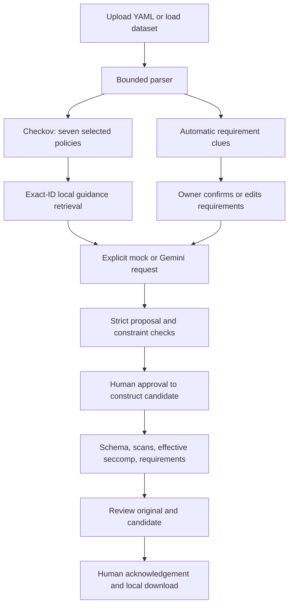

# Architecture and trust boundaries

ConfigShield AI reviews one Linux `apps/v1` Deployment containing one application container. It does not connect to a cluster, build images, execute workloads, or deploy configurations.

## Responsibilities

React controls the review session in memory. Selecting a file or dataset starts supported-structure parsing, scanning, and local retrieval. Explicit buttons permit retrying parse/scan. No generation request follows automatically. A new file clears old requirements and all downstream approvals; changing a requirement or finding clears obsolete proposals/candidates.

FastAPI bounds input bytes before PyYAML parses them. The parser rejects aliases, duplicate keys, multiple documents, excessive complexity, extra containers, and unsupported resource/OS structure. Parse success is not a schema or security verdict. Deterministic requirement hints show limited YAML clues; draft values remain Unknown in downstream requests until the owner accepts or edits them.

Checkov runs as a subprocess in its separate pinned environment, against a temporary copy with a sanitized environment, fixed arguments, and timeout. Only seven checks are normalized into the result. Exit code 1 is expected when findings exist. Skips or tool failures remain incomplete, not passes. Uploaded temporary scan files are removed afterward.

## Lightweight RAG

The knowledge base is a small reviewed collection of paraphrases from Kubernetes and OWASP. Retrieval maps an exact Checkov ID to applicable documents, with source URLs, review dates, scope, and limitations. This is deterministic retrieval augmentation, not embedding search, web crawling, or model training. The dataset is a different collection: synthetic and external YAML inputs for testing the workflow.

Gemini receives selected typed security settings, retrieved guidance, and confirmed requirements. The projection omits raw YAML, names, images, commands, environment values, annotations, and mounts. The returned JSON is checked against a strict schema, retrieved document IDs, and a rule-specific field/value allowlist. Retrieved text and model output are untrusted. Cited source IDs demonstrate provenance, not correctness of every generated statement.

## Candidate verification

The backend binds the original to its hash, rechecks the selected failure, applies supported assignments to a deep copy, and refuses known requirement conflicts. Approval constructs a separate candidate; it never edits the original. Change bullets use actual parsed original values and approved assignments, with the proposed rationale clearly labeled.

Verification independently checks original/candidate structure, allowed semantic differences, strict kubeconform schema validation, fresh comparable Checkov scans, targeted repair, new/remaining findings, and declared requirements. Findings are compared by rule and resource identity. For seccomp repairs, an additional effective-container check rejects pod defaults masked by an insecure container profile and privileged containers that bypass seccomp. Static RuntimeDefault selection still does not prove application syscall compatibility.

The browser binds export to the exact reviewed original/candidate hashes and validation results. It requires a separate final acknowledgement, shows remaining findings and mock/live provenance, and blocks failed, incomplete, conflicting, or regressing candidates. Some candidates remain downloadable explicitly as manual-review drafts, not verified-safe deployments. Original downloads preserve the input bytes.

## AI and storage boundaries

`backend/.env` is backend-only and Git-ignored. Process variables override it. Status checks report configuration readiness and send no Gemini requests. Live use requires the reviewed model and the owner's confirmation that billing is disabled; the app cannot inspect billing or guarantee project quota. Each generation has one attempt, no automatic retry, no tools, a timeout, and no paid/provider fallback. The UI process cap is not account-wide.

Uploads, requirements, and candidates are not persisted by the application. Scanner/validator temporary files are cleaned up. The explicit evaluation CLI and browser checks write local ignored artifacts; downloaded YAML is saved only through user action. Knowledge and dataset source files are repository assets. No telemetry, cluster deployment, automatic publication, or external messaging is implemented.

## Extension points and limits

`AIProvider.generate(prompt)` returns structured text and provider usage. `check_constraints(original, candidate, requirements)` returns conflicts and uncertainty. `verify_candidate(request)` returns independently recomputed checks. Optional verifier callbacks support exact-content caching in offline evaluation; the application uses real default tools. The evaluation runner keeps expected annotations and observed measurements separate.

Not assessed: image provenance, secrets in arbitrary YAML, every Kubernetes policy, cluster admission/RBAC behavior, real credentials, runtime workload compatibility, availability, or production-scale concurrency. Windows local development is the verified target. Multi-container workloads and production hosting need separate design and validation.
